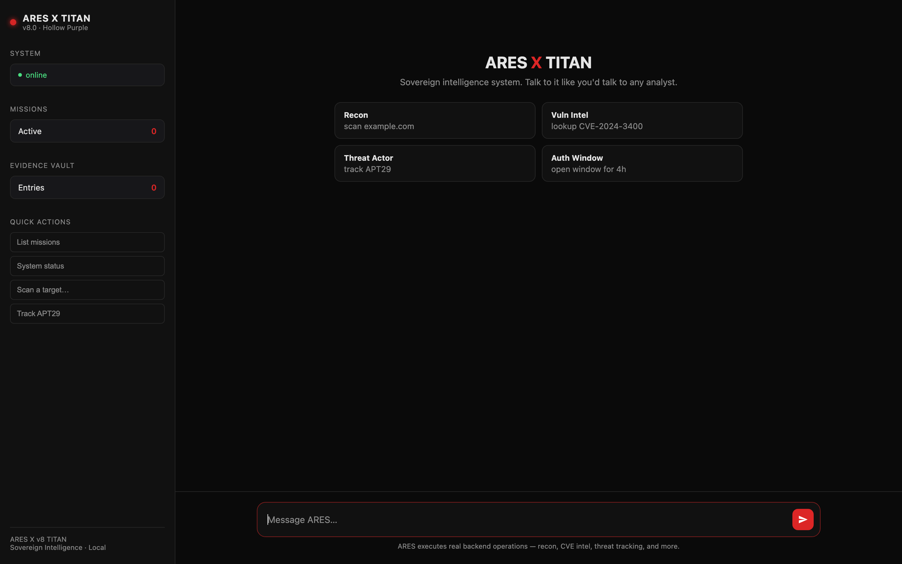
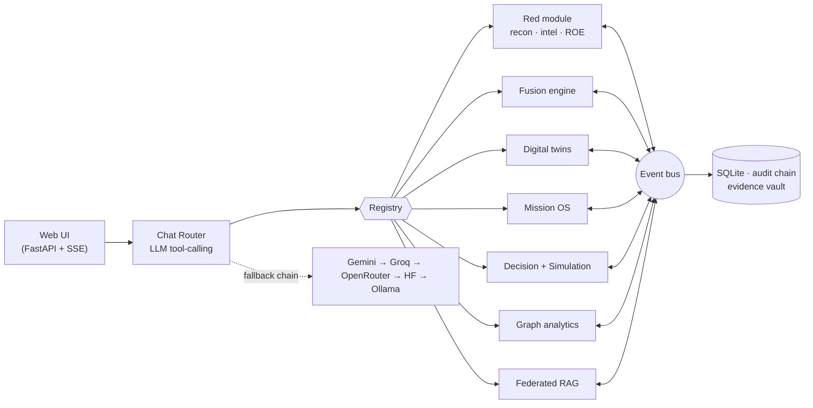

<div align="center">



# ARES X · Neural Architecture

**A sovereign intelligence OS you talk to like an analyst.**
Recon, threat intel, sensor fusion, digital twins, mission control and wargaming — one local-first platform, driven by natural language.


*Built for **Yugantar by Scaler***

</div>

---

## The problem

Security and intelligence analysts juggle a dozen disconnected tools — a scanner here, a CVE feed there, a spreadsheet of threat actors, a wiki for reports. Context is lost between tools, evidence isn't traceable, and "who authorised this scan?" is answered in a Slack thread.

## The idea

**ARES X puts one conversational brain in front of all of it.** Say *"scan example.com"*, *"lookup CVE-2024-3400"*, *"track APT29"*, or *"open an authorization window for 4h"* — an LLM picks the right backend tool, runs it, and every result lands in a shared, auditable intelligence graph.

```
you ▸ track APT29
ares ▸ [threat_actor] 14 TTPs mapped to ATT&CK · 3 linked IOCs · added to mission "Hollow Purple"
```

## What's inside

| Layer | What it does |
|---|---|
| 🧠 **LLM tool router** | Natural-language → function calls. Gemini function-calling first, with Groq / OpenRouter / HF / local Ollama fallbacks and a regex fallback so it still works with no key. |
| 🔴 **Red module** (`aresx/red`) | Pure-Python recon (subdomains, async port scan, tech/WAF fingerprinting, header analysis), CVE intel, threat-actor profiling, IOC engine, GitHub-dork leak detection, infra pivoting, CVSS calculator, ATT&CK kill-chain builder, report generator. |
| 🛡️ **Rules of Engagement** | Nothing network-facing runs unattended by default. Operators open a *time-boxed, case-labelled authorization window*; outside it every target triggers a live y/n prompt. Windows always expire on their own. |
| 🔀 **Sensor fusion** | Multi-source, multi-domain evidence → fused assertions with a confidence model (weighted mean + corroboration bonus − contradiction penalty), per-source reliability that learns, auto-resolution of contradictions, and natural-language explanations. |
| 🪞 **Digital twins** | Org, infra, human (privacy-gated), adversary, supply-chain, cyber-terrain and timeline twins with freshness tracking and diffing. |
| 🎯 **Mission OS** | Missions, objectives, branching, live ops feed, replay, health scoring, task and resource allocation. |
| ⚖️ **Decision intelligence** | Cost-benefit, risk-impact matrices, decision trees, scenario analysis, recommended actions. |
| 🎲 **Simulation & wargaming** | Threat propagation, what-if analysis, economic-impact estimates, red-vs-blue wargames on ATT&CK. |
| 🕸️ **Graph analytics** | Influence mapping, community detection, centrality, hidden-relationship discovery, network vulnerability (NetworkX; Kuzu optional). |
| 🗄️ **Enterprise layer** | Hash-chained evidence vault, human approval gates, watchlists, brief generator, data lineage + provenance, template library. |
| 🔐 **Security & compliance** | Hybrid vault, HSM abstraction, zero-trust, key rotation, SOC 2 / NIST CSF exports. Kyber-768 + Dilithium-3 via `liboqs` when installed, classical fallback otherwise. |
| 📚 **Federated RAG** | Document ingestion, embeddings, vector store, entity resolution and federated search. |
| 🧩 **Plugins** | Sandboxed plugin system with a marketplace layer. |

## Architecture

Hub-and-spoke: subsystems never import each other — they talk over an **event bus** and a **registry**.



Design rules (full write-up in [`docs/ARCHITECTURE.md`](docs/ARCHITECTURE.md)): one wire (bus + registry), no god files, `__init__` exports only, one storage layer, one router, every third-party dependency optional and lazy — a bare install boots cleanly and degrades gracefully.

## Quickstart

```bash
git clone https://github.com/satanonsteroids2024-zzz/ARES-X.git
cd ARES-X
python3 -m venv .venv && source .venv/bin/activate
pip install -r requirements.txt

# optional — free keys, ARES also runs with none (regex fallback / local Ollama)
export GEMINI_API_KEY=...     # https://aistudio.google.com
export GROQ_API_KEY=...       # https://console.groq.com

python main.py server         # → http://localhost:8000
```

First launch shows a setup screen; paste a key or *skip* to run offline. `config.json` and `titan.db` are generated locally on first run and are git-ignored.

Try these in the chat box: `lookup CVE-2024-3400` · `track APT29` · `scan example.com` · `list missions` · `system status`

## Tests

```bash
python -m unittest discover -s tests -t .
# Ran 122 tests … OK (skipped=2)
```

Covers storage + audit chain, fusion (including a "Microsoft" multi-source acceptance test), digital twins, mission OS, decision/simulation/enterprise, security/RAG/graph, and a restructure stress suite.

## Responsible use

ARES X is built for **authorized** security work — red-team engagements, defensive research, CTFs and education. The ROE gate exists so scans only run against targets you have explicitly approved. Don't point it at systems you don't own or have written permission to test.

## Repo map

```
main.py              single launcher (server | desktop | native)
ares_server.py       FastAPI app + SSE chat streaming
frontend/            single-file web UI
aresx/
  chat/              LLM tool router + intent ramps
  red/               recon, vuln intel, threat actors, ROE, ATT&CK
  fusion/            confidence, contradictions, correlators
  domains/           twin · ai · rag · security implementations
  mission/ decision/ simulation/ graph_command/ enterprise/
  bus/ registry.py   the two wires everything uses
  storage/           SQLite layer, migrations, optional Kuzu graph
tests/               122 tests across all phases
docs/                architecture notes + build log
packaging/           Linux/Kali desktop install (systemd, .desktop)
```

## Status & roadmap

Honest snapshot: the server, chat router, red module, fusion, twins, mission, decision, simulation, graph and enterprise layers are implemented and tested. The desktop (Qt orb / wake-word) mode referenced by `main.py desktop` is not included in this build; some `sovereign_ai` / `rag_federated` entries are compatibility shims over `aresx/domains/`. Next up: richer UI panels for twins and simulations, hosted-model-free reasoning via local models, and a plugin marketplace.

---

<div align="center"><sub>ARES X · sovereign, local-first, auditable.</sub></div>
